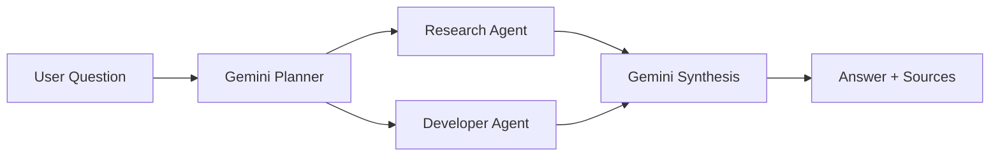

<div align="center">

# Multi-Agent AI Platform

**One question. Two agents. One combined answer.**

Three Teams · Four Meetings · Docker on Akash

</div>

---

## The Core

Gemini splits a complex question into independent research and developer tasks. Both agents run concurrently, report live tool activity to the dashboard, and return structured findings for Gemini to synthesize into an answer with sources.



**Focus:** AI tool pipelines, concurrent coordination, Docker deployment, and a polished dashboard. React + Tailwind power the interface; FastAPI coordinates the services. Akash is the target deployment environment.

> **Starter status:** The end-to-end mock workflow works without API keys. The shared framework is implemented; real research and developer tools remain team assignments.

## Teams & Guides


| Team                | Owns                                                      | Start here                                                                    |
| :------------------ | :-------------------------------------------------------- | :---------------------------------------------------------------------------- |
| **A · Research**   | Search, papers, Wikipedia, PDFs, notes, weather           | [Research guide](agents/research/README.md)                                   |
| **B · Developer**  | GitHub, browsing, Python/C++, DuckDB, repo analysis       | [Developer guide](agents/developer/README.md)                                 |
| **C · Full Stack** | Planning, orchestration, synthesis, dashboard, deployment | [Backend & integration](backend/README.md) · [Dashboard](frontend/README.md) |

Each agent starts with `app.py` and `tools.py`. All teams use the same [contracts, Gemini helper, and tool-event protocol](shared/README.md). Keep API keys in each service's ignored `.env` file.

Develop on team-prefixed branches and review small pull requests. Merge and connect the team implementations during Meeting 3; coordinate shared-interface changes with affected teams.

## Quick Start

For Meeting 3 integration, run from the repository root with Docker running:

```bash
python3 scripts/setup_env.py
docker compose up --build
```

See the [dashboard guide](frontend/README.md#local-development) and [backend guide](backend/README.md#run-the-backend) for service instructions. For local development and verification, see the [shared starter guide](shared/README.md#development--checks).

## Four-Meeting Roadmap

**Integration starts in Meeting 3.** Meetings 1–2 focus on independent team development against agreed interfaces and local fixtures; Meeting 4 is the final presentation.


| Meeting               | Team A · Research                                                                   | Team B · Developer                                                             | Team C · Full Stack                                                                             |
| :-------------------- | :----------------------------------------------------------------------------------- | :------------------------------------------------------------------------------ | :----------------------------------------------------------------------------------------------- |
| **01 · Foundations** | Set up keys and shared helpers; start Brave, Wikipedia, and local tool-event checks. | Set up keys and shared helpers; start GitHub API and local tool-event checks.   | Agree contracts; develop FastAPI and dashboard skeletons independently with fixtures.            |
| **02 · Development** | Complete research tools and validate structured results independently.               | Complete developer tools and validate structured results independently.         | Build and test planning, orchestration, synthesis, and dashboard components with local fixtures. |
| **03 · Integration** | Dockerize and connect the real research pipeline; verify events and sources.         | Dockerize and connect the real developer pipeline; verify events and artifacts. | Integrate real outputs, polish the dashboard, deploy, and rehearse.                              |
| **04 · Final Demo**  | Present the research pipeline and tools.                                             | Present the developer pipeline and tools.                                       | Present the dashboard, architecture, and integrated application.                                 |

**Meeting 3 checkpoint:** Connect both real agents, backend, and dashboard; verify concurrent execution, live tool events, combined results, and deployment on Akash.
